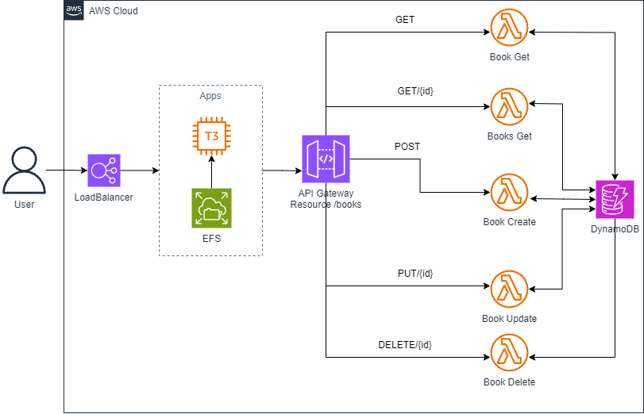

# Books Portal Application

Full-stack books management portal backed by Amazon API Gateway, AWS Lambda, DynamoDB, EC2, and EFS.

## Architecture



## AWS Lambda Functions (`Python 3.12`)

| Function | Source File | Route & Method |
|---|---|---|
| Book Get (List) | [`lambda/bookget.py`](lambda/bookget.py) | `GET /books` |
| Book Create | [`lambda/bookcreate.py`](lambda/bookcreate.py) | `POST /books` |
| Books Get (Detail) | [`lambda/booksget.py`](lambda/booksget.py) | `GET /books/{id}` |
| Book Update | [`lambda/book-update.py`](lambda/book-update.py) | `PUT /books/{id}` |
| Book Delete | [`lambda/book-delete.py`](lambda/book-delete.py) | `DELETE /books/{id}` |

<details>
<summary>API Gateway Mapping Templates (Non-Proxy Reference)</summary>

- **`POST /books`**
  ```vtl
  $input.json('$')
  ```
- **`PUT /books/{id}` & `GET /books/{id}`**
  ```json
  {
    "body": $input.json('$'),
    "pathParameters": {
      "id": "$input.params('id')"
    }
  }
  ```
- **`DELETE /books/{id}`**
  ```json
  {
    "pathParameters": {
      "id": "$input.params('id')"
    }
  }
  ```

</details>

## EC2 Application Setup (Amazon Linux 2023)

1. **Install Node.js 22 LTS & EFS Utilities**
   ```bash
   curl -fsSL https://rpm.nodesource.com/setup_22.x | sudo bash -
   sudo dnf install -y nodejs git amazon-efs-utils
   ```

2. **Mount Amazon EFS**
   ```bash
   # Using EFS Mount Helper
   sudo mount -t efs -o tls <EFS_ID>:/ efs

   # Or using NFSv4 Client
   sudo mount -t nfs4 -o nfsvers=4.1,rsize=1048576,wsize=1048576,hard,timeo=600,retrans=2,noresvport <EFS_DNS>:/ efs
   ```

3. **Install Dependencies**
   ```bash
   npm install
   ```

4. **Configure Environment Variables**
   Set the following variables in your application path:
   - `API_URL` — your API Gateway invoke URL
   - `EFS_LOG_PATH` — your EFS log path

5. **Run Application**
   ```bash
   npm run start-prod
   ```
